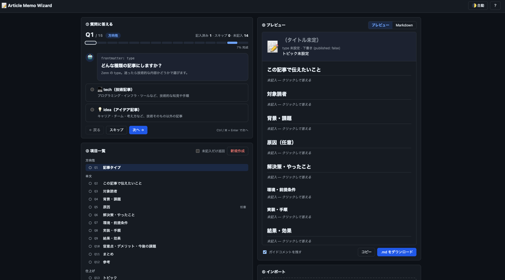
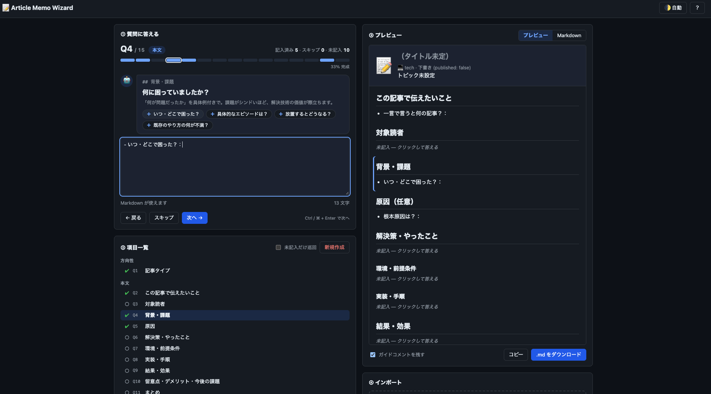
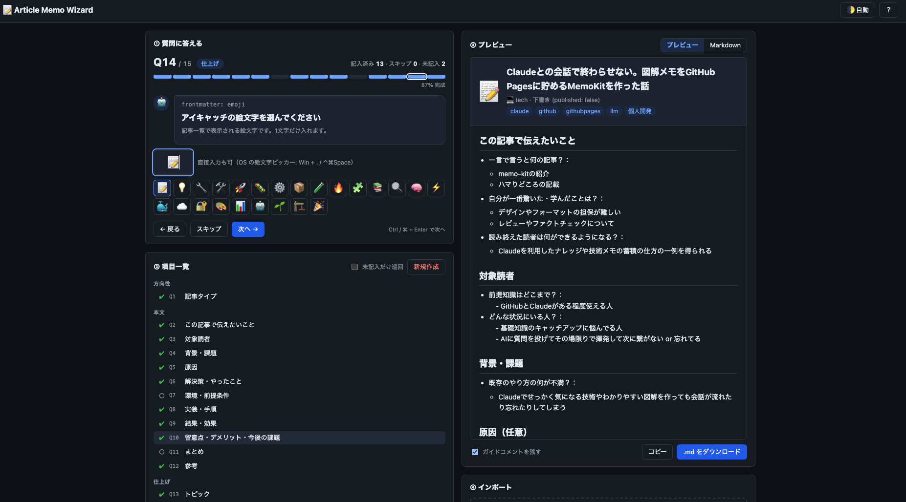
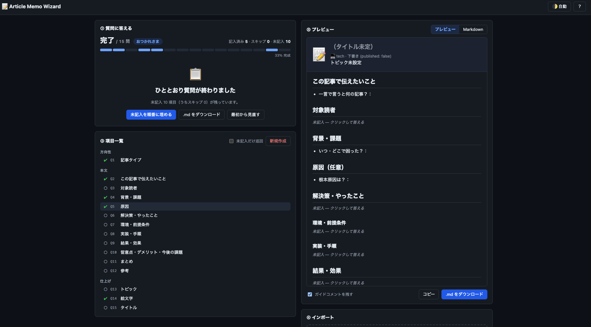

## この記事で伝えたいこと

- 質問に順番に答えるだけで、Zenn記事のテンプレートに沿った「記事を書く前のメモ」が作れるツールを作りました
- 書きかけのメモを読み込むと、まだ埋まっていない項目から続きを質問してくれます
- HTML 1枚・ビルド不要・入力は外部に送らない、というPoCとして割り切った作りと、その中で工夫した点を紹介します

## 対象読者

- 技術記事を書きたいのに、エディタを開いたところで手が止まってしまう人
- 記事テンプレートは用意しているものの、見出しを眺めるだけで埋まらない人

## 背景・課題

記事を書くために、以前 [Dev containerでZennの執筆環境](https://github.com/taka1156/zenn-writing-environment) を作り、記事のテンプレートも用意しました。テンプレートには「この記事で伝えたいこと」「背景・課題」「結果・効果」などの見出しと、各見出しで何を書くかのガイドコメントが入っています。

```markdown
## 背景・課題
<!-- 技術は課題を解決するための仕組み。「何が問題だったか」を具体例付きで。
     課題がシンドいほど、解決技術の価値が際立つ。 -->
```

ところが、テンプレートをコピーしてエディタで開いても、見出しが並んでいるだけの画面を前にすると、どこから書けばいいのか分からなくなります。結局「あとで書こう」となり、ネタだけが溜まっていく状態でした。

## 原因

振り返ると、原因は次の2つだと考えています。

- **テンプレートは「何を書くか」は示してくれるが、「問いかけ」はしてくれない**
  見出しを見て自分で問いを立てる必要があり、そこで手が止まる
- **全部の見出しが一度に見えてしまう**
  埋まっていない見出しが多いと、最初の一歩が重く感じる

人に「何に困ってたの？」「具体的には？」と聞かれると意外とスラスラ話せるので、**一度に1つずつ質問してもらえれば書ける**のではないか、と考えました。

## 解決策・やったこと

テンプレートの各見出しを質問に置き換え、1問ずつ答えていくウィザード形式の「記事メモウィザード」を作りました。自作ツール置き場の [tool](https://github.com/taka1156/tool) に追加しています。

https://tool.taka1156.site/feat/article_memo.html





主な機能は次のとおりです。

- **ウィザード形式の質問**：全15問。「Q4 / 15」のような番号と、1問1マスの進捗バーで現在地が分かります。マスは記入済み・スキップ・未記入で色分けしていて、クリックするとその質問に移動します
- **深掘り質問**：「いつ・どこで困った？」「数値で言うと？」のようなボタンを押すと、回答欄に問いが差し込まれます
- **スキップ**：答えにくい質問は後回しにできます。全問終わったあとに「未記入を順番に埋める」で戻れます
- **プレビュー**：右側に記事の形でリアルタイムに表示します。見出しをクリックすると、その質問に移動します
- **Markdownのエクスポート / インポート**：テンプレートと同じ形式で書き出し、書き出したファイルや書きかけの記事を読み込めます
- **ダークモード**：初期状態はOSの設定に従い、ライト / ダークにも切り替えられます

### 環境・前提条件

- HTML 1枚で完結（CSS / JavaScriptはインライン、ビルド不要）
- 外部ライブラリは CDN から読み込む [marked](https://marked.js.org/)（プレビュー）、[DOMPurify](https://github.com/cure53/DOMPurify)（サニタイズ）、[driver.js](https://driverjs.com/)（使い方ツアー）のみ
- 入力内容はブラウザの `localStorage` に自動保存し、外部サーバーには送りません

### 実装・手順

#### 1. テンプレートの見出しを「質問」に置き換える

まず、テンプレートの見出しごとに「質問文」「ヒント（ガイドコメントの要約）」「深掘り質問」を定義しました。書き出しのときにテンプレートどおりのコメントを残せるように、元のコメントも持たせています。

```js
{
  id: 'background', label: '背景・課題', kind: 'textarea',
  heading: '背景・課題', level: 2,
  q: '何に困っていましたか？',
  hint: '「何が問題だったか」を具体例付きで。課題がシンドいほど、解決技術の価値が際立ちます。',
  deep: ['いつ・どこで困った？', '具体的なエピソードは？', '放置するとどうなる？', '既存のやり方の何が不満？'],
  comment: '<!-- 技術は課題を解決するための仕組み。…… -->'
}
```

質問の順番は、テンプレートの見出し順そのままではなく **記事タイプ → 本文 → トピック → 絵文字 → タイトル** にしました。テンプレートに「タイトルは書き終わった後に決める」と書いてあるとおり、タイトルは内容が固まってから考えたほうが楽だからです。タイトルの質問では「Xした話」「XでYを解決した」などの型をボタンで選べるようにし、参考として「この記事で伝えたいこと」の回答も横に表示しています。

#### 2. テンプレートと同じ形式で書き出す

書き出しでは、埋まっていない項目もテンプレートの状態を保つようにしました。たとえばタイトルが未入力なら、元のテンプレートと同じくコメント付きの空文字を出力します。

```js
out.push(isFilled('title')
  ? 'title: ' + yq(a.title.trim())
  : 'title: "" # ' + TITLE_COMMENT);
```

こうしておくと、書き出したファイルをそのまま `articles/` に置いても、テンプレートから作った記事と見分けがつきません。ガイドコメントは「残す / 消す」を選べます。



#### 3. 読み込んだら「埋まっていない項目」から質問する

一番こだわったのがインポートです。書きかけのメモを読み込むと、空の項目だけを順番に質問するモードに自動で切り替わります。

Markdownを `##` / `###` の見出しで区切り、テンプレートの見出しと照合して各項目に振り分けています。このとき、次の2点に気をつけました。

- **コードブロック内の `##` を見出しとして扱わない**
  ```` ``` ```` / `~~~` の開始と終了を追いかけて、コードブロックの中は区切らないようにしています
- **テンプレートにない見出しを消さない**
  自分で足した `### 手順1` のような見出しは、直前の項目の後ろに「そのまま保持」して書き出します。ツールを通したら内容が消えていた、という事故を防ぐためです

```js
const id = HEADING_MAP[normHeading(sec.heading)];
if (id && answers[id] === undefined) {
  answers[id] = cleanBody(content, STEP_BY_ID[id].kind);
  last = id;
} else {
  // テンプレート外の見出しは、直前の項目の後ろに残す
  extras.push({ after: last, text: (sec.line + '\n' + content).trim() });
}
```

見出しの照合では空白や全角・半角の括弧の違いを吸収し、「原因（任意）」は「原因」だけでも一致するようにしています。

## 結果・効果

まだPoCの段階なので、記事を書くまでの時間が何分短くなった、といった効果は測れていません。現時点で確認できているのは次のとおりです。

- 書き出したMarkdownを読み込み直して再度書き出すと、元と同じ内容になる（往復しても崩れない）
- テンプレートをそのまま読み込むと、最初の質問から順に聞いてくれる
- スマホ幅（375px）でも横スクロールが出ずに使える

使ってみた感覚としては、「何に困っていましたか？」と1問だけ表示されるほうが、見出しの並んだエディタを開くより書き始めやすいと感じています。この記事自体も、このウィザードの項目に沿って書いています。

## 留意点・デメリット・今後の課題

- **質問は固定**：回答の内容に応じて追加で質問してくれるわけではありません。深掘り質問のボタンは、あくまで問いのきっかけです
- **保存はブラウザごと**：`localStorage` に保存しているので、別のブラウザや端末とは共有されません。端末をまたぐときは `.md` で書き出して持ち運ぶ前提です
- **テンプレートが変わったらツールも直す必要がある**：見出しと質問の対応をコードに直接書いているため、テンプレートを変更したらツール側の定義も更新が必要です

この課題の解決として以下を検討しています

- JSONとして設定を切り出してエクスポート/インポートする機能
  JSONであれば、AIと壁打ちしながら作れますし、JSON Schemaでデータ構造を示しやすいことも利点になると思います。
- Cloudflare WorkersとGitHub REST APIで直接、記事メモ管理ブランチにメモを生成する
  以下のエンドポイントを叩くとすでにファイルがあれば更新、なければ新規作成扱いでファイルを入れることができようなので要検討
  `PUT https:/api.github.com{owner}/{repo}/contents/{path}`

## まとめ

- テンプレートの見出しを1問ずつの質問に置き換えるだけで、書き始めのハードルがだいぶ下がりました
- 書きかけのメモを読み込めば、埋まっていない項目から続きを聞いてくれます
- HTML 1枚で動くので、気になった方はそのまま開いて試してみてください

https://tool.taka1156.site/feat/article_memo.html

## 参考

https://github.com/taka1156/tool
